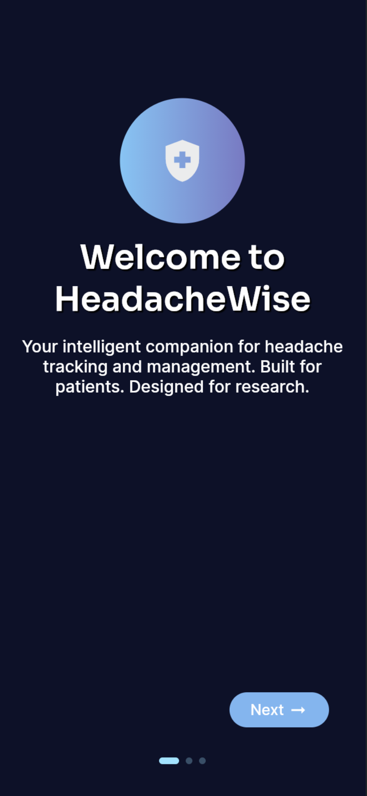
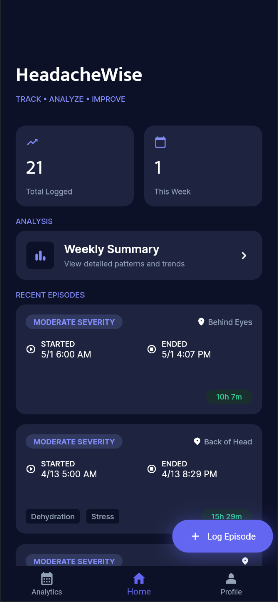
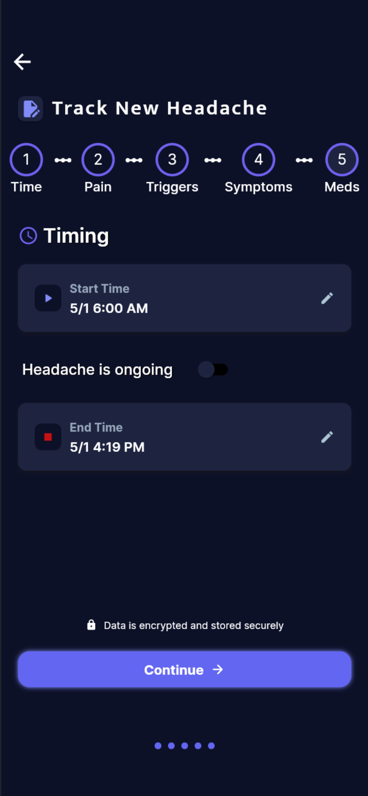
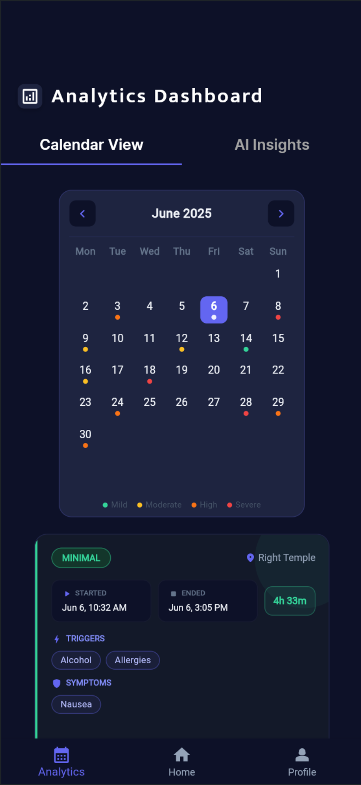
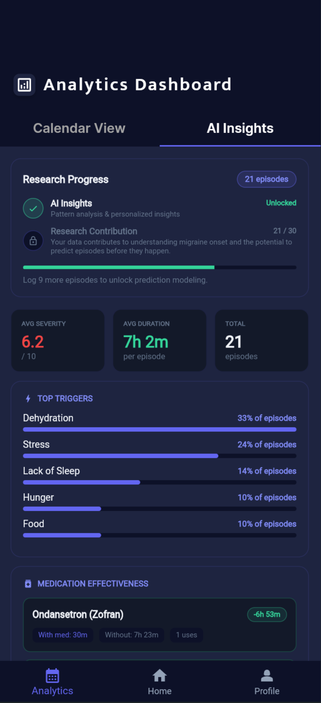

# HeadacheWise

HeadacheWise is an iOS headache and migraine tracking app. You log each episode
in a short guided flow, and the app turns those logs into a calendar, weekly
summaries, on-device statistics (including a ranking of trigger combinations),
and three short AI-generated observations per analysis.

The app is built with Flutter and Firebase. The UI was generated with
FlutterFlow and extended with hand-written Dart in `lib/custom_code/` and
`lib/flutter_flow/custom_functions.dart`.

[Download on the App Store](https://apps.apple.com/us/app/headachewise/id6670711602)

> HeadacheWise is not a medical device and does not provide diagnosis or
> treatment. The in-app text says the same: AI-generated insights are for
> informational purposes only and do not constitute medical advice.

## Contents

- [Screenshots](#screenshots)
- [What the app does](#what-the-app-does)
- [Architecture](#architecture)
- [Data model](#data-model)
- [On-device analytics and the trigger ranking engine](#on-device-analytics-and-the-trigger-ranking-engine)
- [How the Gemini insights are generated](#how-the-gemini-insights-are-generated)
- [Tech stack](#tech-stack)
- [Project layout](#project-layout)
- [Building](#building)
- [Notes on the code](#notes-on-the-code)
- [License](#license)

## Screenshots

| Onboarding | Home | Log an episode |
| --- | --- | --- |
|  |  |  |

| Calendar view | AI Insights tab |
| --- | --- |
|  |  |

## What the app does

**Episode logging.** The log flow has five steps: Time, Pain, Triggers,
Symptoms, Meds. An episode records a start time, an end time or an "ongoing"
flag, a pain location, a 0 to 10 severity, triggers and symptoms chosen from
fixed lists, medications with name and dosage, and free-text notes. The
trigger and symptom lists live in `lib/app_constants.dart`:

- Triggers: Alcohol, Caffeine, Food, Hunger, Dehydration, Stress, Sugar,
  Travel, Weather, Allergies, Physical Activity, Menstrual Period, Lack Of Sleep
- Symptoms: Nausea, Eye Pain, Dizziness, Fatigue, Congestion, Confusion, Aura,
  Fever, Mood Changes, Vision Changes, Light Sensitivity

Severity labels are derived from the numeric value in `severityLabel()`:
0 to 2 Minimal, over 2 to 4 Mild, over 4 to 6 Moderate, over 6 to 8 High,
above 8 Severe.

**Home.** Total episodes logged, episodes this week, a link to the weekly
summary, the most recent episodes, a card for an active (ongoing) headache, and
a floating "Log Episode" button.

**Calendar view.** A month calendar with a severity-colored dot per day
(`CustomHeadacheCalendar`). Selecting a day lists that day's episodes.

**Weekly Analysis.** For a selected week: episode count, average pain, total
duration, a daily severity chart, and the week's symptoms, triggers,
medications, and pain locations, plus an optional AI analysis for that week.

**Episode details.** A per-episode page with the pain timeline, duration, and
intensity.

**AI Insights tab.** The analytics dashboard's second tab renders
`HeadacheAnalysisWidget`, which computes everything described under
[On-device analytics](#on-device-analytics-and-the-trigger-ranking-engine)
and shows the AI-generated observations once the user has 15 or more episodes.

**Ongoing-headache check-in.** A scheduled Cloud Function
(`firebase/custom_cloud_functions/notify_ongoing_headaches.js`) runs every 15
minutes. For each episode that is still marked ongoing, started 8 or more hours
ago, and has not been notified yet, it reads the `fcmTokens` array on the
user's document and sends a push notification titled "Check-in: headache > 8
hours", then marks the episode as notified.

**Accounts.** Sign in with email and password (with account creation and
password reset), Google, or Apple, through Firebase Authentication.

## Architecture

```
Flutter app (iOS, Android, and web targets)
  FlutterFlow-generated pages and components
  Custom widgets and functions (analytics, calendar, cards)
        |
        |  Firebase SDKs, authenticated as the signed-in user
        v
Firebase project
  Authentication         email/password, Google, Apple
  Cloud Firestore        users/{uid} and users/{uid}/Headaches/{id}
  Cloud Messaging        device tokens, push notifications
  Vertex AI in Firebase  Gemini model used for the insight text
  Cloud Functions        token registration, scheduled check-in notifier
```

Key points:

- All statistics shown in the app are computed in Dart on the device from the
  user's Firestore documents. Nothing is precomputed on a server.
- The AI step does not use a Gemini API key in the client. The app calls
  Vertex AI in Firebase through the `firebase_vertexai` package, authenticated
  with the current Firebase user (`FirebaseVertexAI.instanceFor(auth: ...)` in
  `lib/backend/ai_agents/firebase_vertexai_agent.dart`).
- Routing uses `go_router` (`lib/flutter_flow/nav/nav.dart`). Pages:
  IntroSlides, Authentication, ProfileSetup, FirstPage, NewHome,
  LogHeadachePage, AnalysisDashboard, WeeklyFFDesign (the weekly summary),
  Summaries (episode details), ProfileNew, ProfileEdit.
- Local UI state is held in `FFAppState` (`lib/app_state.dart`) with a few
  flags persisted through `shared_preferences`.
- Firestore security rules, indexes, and storage rules are in `firebase/`.

## Data model

Firestore collections, as read by `lib/backend/schema/`:

`users/{uid}` (`UsersRecord`)

| Field | Type |
| --- | --- |
| email, displayName, firstName, uid, photoUrl, phoneNumber | string |
| createdTime, birthday | timestamp |
| sex | bool |
| research | bool |
| ouraConnected | bool |

`users/{uid}/Headaches/{id}` (`HeadachesRecord`)

| Field | Type |
| --- | --- |
| startTime, endTime, createdAt | timestamp |
| painLocation, notes | string |
| triggers, symptoms | list of string |
| medications | list of `{ name, dosage }` |
| ongoing | bool |
| greatestSeverity | double, 0 to 10 |

The Headaches subcollection is also queried as a collection group by the
check-in Cloud Function.

## On-device analytics and the trigger ranking engine

`lib/custom_code/widgets/headache_analysis_widget.dart` receives the user's
episode list and computes, in Dart:

- **Summary stats.** Average `greatestSeverity` across all episodes, average
  duration across completed episodes (end minus start, in minutes), and the
  total count.
- **Top triggers.** Trigger frequency across episodes, shown as the top five
  with the share of episodes each appears in.
- **Medication effectiveness.** For each medication name, the average duration
  of completed episodes where it was taken versus completed episodes where it
  was not, sorted by the size of the reduction. The top four are shown.
- **Symptom frequency.** The top ten symptoms with their share of episodes.
- **Trigger combinations.** The ranking engine described next.
- **Milestones.** AI insights unlock at 15 episodes. A second milestone at 30
  episodes is displayed as "Research Contribution"; no prediction model ships
  in this repository.

### Trigger combination ranking

`_triggerCombinations()` ranks pairs and triples of triggers that recur
together. The steps:

1. Require at least 10 logged episodes, otherwise return nothing.
2. Keep only episodes with two or more triggers (the "eligible" set).
3. For each eligible episode, sort its triggers alphabetically and enumerate
   every pair and every triple. For each combination, accumulate the episode's
   `greatestSeverity`, and its duration in minutes when the episode is
   completed.
4. Drop any combination seen in fewer than two episodes.
5. Score each remaining combination in one of two modes, sort descending, and
   display the top five with a Pair or Triple badge, episode count, mean
   severity, and mean duration.

**Standard mode (composite score).** Each combination's mean severity and mean
duration are divided by the maximum mean across all combinations, so both land
in 0 to 1, then combined:

```
compositeScore = 0.6 * normalizedSeverity + 0.4 * normalizedDuration
```

Scores are relative to the user's own history: a high score means "worst in
your history", not "clinically severe". The code comments say the same.

**Research mode (lift).** Each trigger is treated as a multiplicative severity
factor over the user's overall mean, so the severity predicted for a
combination under independence is the product of the individual trigger means
scaled back by the global mean. Lift is observed divided by predicted:

```
mu_global = mean severity over all eligible episodes
mu(X)     = mean severity over eligible episodes that include trigger X

predicted(A, B)    = mu(A) * mu(B) / mu_global
predicted(A, B, C) = mu(A) * mu(B) * mu(C) / mu_global^2

lift = mean severity of the combination / predicted
     = mu_combo * mu_global^(n - 1) / (mu(X_1) * ... * mu(X_n))
```

Interpretation, as written in the source: lift above 1 means the combination
is more severe than its parts predict (synergistic), lift of 1 means the
individual triggers fully explain the severity, and lift below 1 means the
combination is milder than predicted. In this mode the card shows a LIFT badge
and the score as a multiplier such as `1.35x`, with the bar mapped so that a
lift of 2.0 fills it.

The mode is selected by the widget's `researchMode` parameter. The
AnalysisDashboard page currently constructs the widget without that parameter,
so the composite ranking is what the shipped dashboard shows; passing
`researchMode: true` switches it to lift.

## How the Gemini insights are generated

There are two entry points, and both follow the same pattern: Dart computes
the statistics and assembles a plain-text prompt, the prompt is sent to a
Gemini model through Vertex AI in Firebase, and the returned text is shown as
is.

**1. AI Insights tab (`generateTrendsPrompt` in
`lib/flutter_flow/custom_functions.dart`).** Triggered when the user opens the
tab with 15 or more episodes. The prompt is built from:

- the user's age (computed from the profile birthday) and sex, episode totals,
  average severity, and average duration;
- trigger frequency and symptom frequency, top eight each, with counts and
  percentages;
- per-medication average episode duration and a no-medication baseline;
- time-of-day distribution (morning 5 to 12, afternoon 12 to 17, evening 17 to
  21, night otherwise) and the three most frequent weekdays;
- a one-line-per-episode log (date and time, severity, duration, location,
  triggers, symptoms, medications);
- instructions to return exactly three plain-text bullets, each with a
  specific number and an actionable implication.

**2. Weekly Analysis page (`generateWeeklyAIPrompt`).** Triggered by the
"Generate AI Analysis" button. The prompt lists the selected week's entries
(start, end, severity, symptoms, triggers, location, medications, notes) and
asks for three short tips.

Both prompts go through `callAiAgent()` in `lib/backend/ai_agents/ai_agent.dart`
with the agent definition that FlutterFlow embeds in the page code:

| Setting | Value |
| --- | --- |
| Provider | Google, via Vertex AI in Firebase |
| Model | `gemini-2.5-flash` |
| Temperature | 0.3 |
| Top-p | 0.95 |
| Max output tokens | 1500 |
| Response type | plain text |

The system instruction tells the model it is HeadacheWise, to output exactly
three concise bullet-point observations separated by blank lines, to use no
markdown, and to cite a source for each fact in parentheses.
`ChatManager` keeps one chat session per thread id, so repeated requests on
the same screen continue the same conversation.

Note that the prompt includes per-episode lines, not only aggregates, so the
user's logged episode data is sent to the model when they request an analysis.

`lib/backend/gemini/gemini.dart` is a FlutterFlow helper for calling Gemini
directly with an API key. It is not called anywhere in the app and holds a
placeholder key.

## Tech stack

- Flutter and Dart. `pubspec.yaml` requires a Dart SDK from 3.0.0 up to 4.0.0;
  the project was last resolved with Flutter 3.41.7 (stable) and Dart 3.11.5.
- FlutterFlow for the generated UI, with custom widgets, a custom action, and
  custom functions written by hand.
- Firebase: `firebase_core` 3.14.0, `firebase_auth` 5.6.0,
  `cloud_firestore` 5.6.9, `cloud_functions` 5.5.2,
  `firebase_messaging` 15.2.7, `firebase_performance` 0.10.1+7,
  `firebase_vertexai` 1.0.1.
- Sign-in: `google_sign_in` 6.3.0, `sign_in_with_apple` 7.0.1.
- App infrastructure: `go_router` 12.1.3, `provider` 6.1.5, `rxdart` 0.27.7,
  `shared_preferences` 2.5.3.
- UI: `fl_chart` 1.0.0, `flutter_animate` 4.5.0, `google_fonts` 6.3.3,
  `font_awesome_flutter` 10.7.0, `smooth_page_indicator` 1.1.0,
  `percent_indicator` 4.2.2, `timeago` 3.7.1, `intl` 0.20.2.
- Cloud Functions: Node 20, `firebase-admin` 11, `firebase-functions` 4.
- Platforms: iOS 14.0 or later (`ios/Podfile`), Android minSdk 23 and
  targetSdk 36 (`android/app/build.gradle`), and a web target. The App Store
  listing is the iOS build; the app version in `pubspec.yaml` is 3.0.3+1.

## Project layout

```
lib/
  main.dart                      app bootstrap, Firebase init, router
  app_state.dart                 FFAppState (local UI state)
  app_constants.dart             trigger and symptom lists
  auth/                          Firebase Auth wrappers (email, Google, Apple)
  backend/
    schema/                      Firestore record classes and structs
    firebase/firebase_config.dart.example   template for the git-ignored config
    ai_agents/                   callAiAgent and the Vertex AI chat manager
    cloud_functions/             callable function helper
    push_notifications/          FCM token registration and handlers
    gemini/                      unused direct-Gemini helper (placeholder key)
  custom_code/
    widgets/headache_analysis_widget.dart   stats and trigger ranking engine
    widgets/custom_headache_calendar.dart   month calendar with severity dots
    widgets/headache_calendar_card.dart     episode card for a selected day
    widgets/active_headache_card.dart       card for an ongoing headache
    widgets/log_episode_fab.dart            floating "Log Episode" button
    actions/launch_oura_u_r_l.dart          opens an external Oura URL (unused)
  flutter_flow/
    custom_functions.dart        weekly stats, prompt builders, formatting
    nav/nav.dart                 go_router routes
    ...                          FlutterFlow theme, widgets, utilities
  analysis_dashboard/            Calendar View and AI Insights tabs
  log_headache_page/             five-step logging flow
  weekly_f_f_design/             Weekly Analysis page
  summaries/                     episode details page
  new_home/, first_page/, intro_slides/, authentication/,
  profile_setup/, profile_new/, profile_edit/, components/

firebase/
  firebase.json                  two function codebases, rules, indexes
  firestore.rules, storage.rules, firestore.indexes.json
  functions/                     FlutterFlow push-notification functions
  custom_cloud_functions/        notifyOngoingHeadaches (every 15 minutes)

android/, ios/, web/             platform projects
assets/                          fonts (Mukta) and images
screenshots/                     images used in this README
test/widget_test.dart            a single smoke test that pumps the app
```

## Building

Firebase configuration is excluded from this repository, so the app will not
build until you add your own. You need a Firebase project with Authentication
(Email/Password, Google, Apple), Cloud Firestore, Cloud Messaging, and Vertex
AI in Firebase enabled.

1. Install Flutter (the project was last built with 3.41.7 stable).
2. Add your Firebase files. All three paths are git-ignored:
   - `android/app/google-services.json`
   - `ios/Runner/GoogleService-Info.plist`
   - `lib/backend/firebase/firebase_config.dart`, created by copying
     `lib/backend/firebase/firebase_config.dart.example` and filling in your
     web app options. `main.dart` imports this file, so the build fails
     without it.
3. In `ios/Runner/Info.plist`, replace the `com.googleusercontent.apps...` URL
   scheme with the `REVERSED_CLIENT_ID` from your own
   `GoogleService-Info.plist`. Google Sign-In on iOS needs it.
4. Fetch dependencies and run:

   ```
   flutter pub get
   flutter run
   ```

5. Deploy the rules and functions from the `firebase/` directory with the
   Firebase CLI, with your project selected (`firebase use` or `--project`).
   `firebase/firebase.json` defines the `functions` and
   `custom_cloud_functions` codebases. Run `npm install` inside each functions
   folder first.

`android/app/build.gradle` defines a release signing config that reads
`android/key.properties` (git-ignored), but its release build type is
currently set to the debug signing config.

## Notes on the code

- Hand-edited files are confined to `lib/custom_code/`,
  `lib/flutter_flow/custom_functions.dart`, and `pubspec.yaml`. The rest of
  `lib/` is FlutterFlow output and is regenerated by FlutterFlow.
- `firebase/functions/package.json` lists several third-party SDKs that
  FlutterFlow adds by default (Stripe, Braintree, Razorpay, Mux, OneSignal,
  LangChain). None of them is imported by the function code in this
  repository.
- `users.ouraConnected` and the `launchOuraURL` custom action are scaffolding
  for an Oura integration. The action is not referenced by any page in this
  version.
- `test/widget_test.dart` only checks that the app widget builds.

## License

MIT. See [LICENSE](LICENSE).
